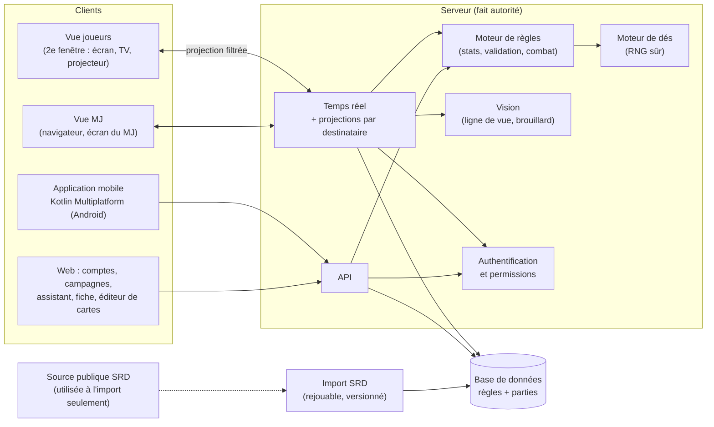
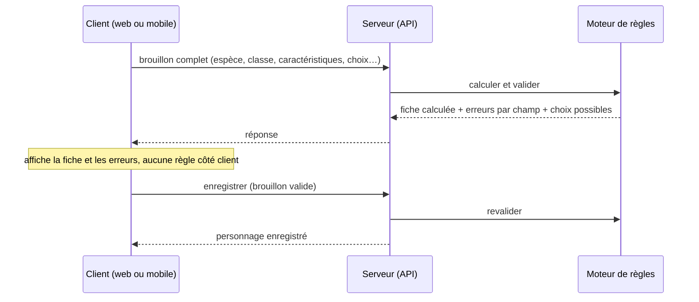
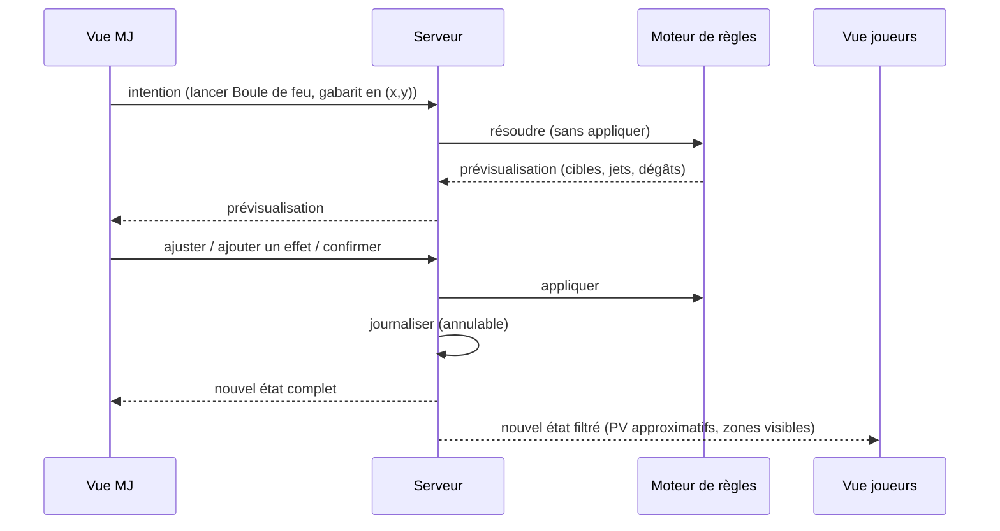

# Architecture (brouillon v1)

> Ce schéma est **indépendant de la stack** ; il sera complété une fois ADR-0004 et 0005 acceptées.

## 1. Composants



Le moteur de règles n'existe **que sur le serveur** (ADR-0003). Le web et le mobile ne contiennent aucune règle : ils envoient les choix de l'utilisateur et affichent le résultat calculé.

## 2. Flux : création d'un personnage (web ou mobile)



## 3. Flux : une action de combat



## 4. Choix de stack

_Renvoyer vers ADR-0003 (moteur), ADR-0004 (serveur, web, base), ADR-0005 (temps réel), ADR-0007 (hébergement), ADR-0002 (mobile)._

## 5. Arborescence du dépôt

_À compléter en M1 (issue « Initialiser le monorepo »)._ Proposition indicative :

```
/
├── apps/
│   ├── server/        API, temps réel, moteur de règles, dés, vision
│   ├── web/           vue MJ, vue joueurs, pages web
│   └── mobile/        projet Kotlin Multiplatform
├── packages/          types et contrats d'API partagés éventuels
├── data/              données SRD figées, campagne de démo
├── scripts/           import SRD, installation
├── docs/
├── .github/           workflows, modèles d'issue et de PR
├── docker-compose.yml
└── README.md
```
