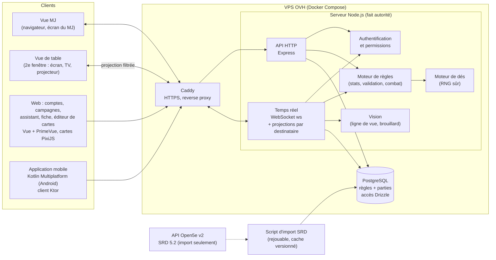
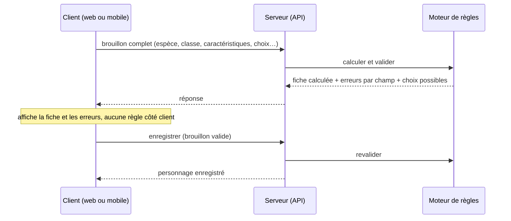
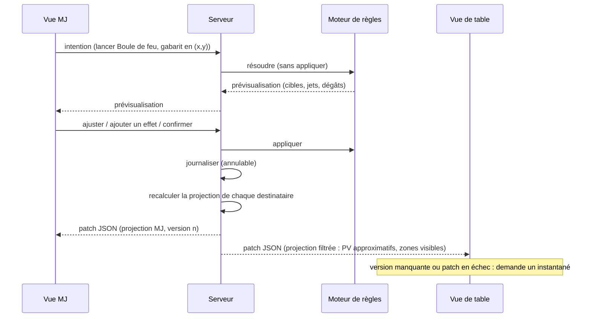
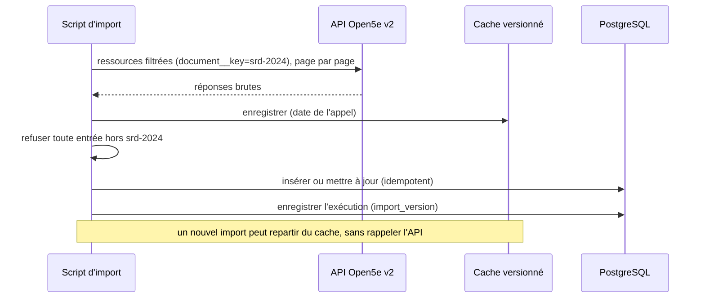
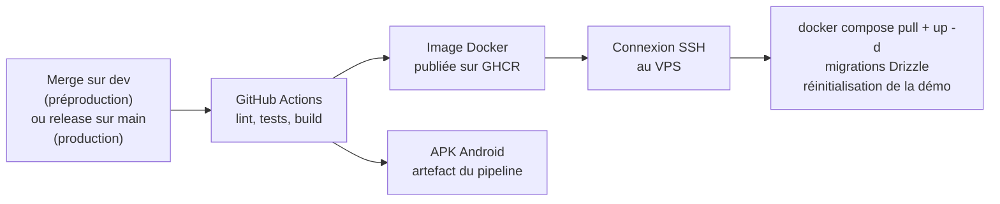

# Architecture (v1)

> Schéma complété avec la stack retenue à l'atelier d'architecture du 2026-11-03 (ADR-0004 à 0007). Les décisions et leurs justifications sont dans les [ADR](adr/).

## 1. Composants



Le moteur de règles n'existe **que sur le serveur** (ADR-0003). Le web et le mobile ne contiennent aucune règle : ils envoient les choix de l'utilisateur et affichent le résultat calculé.

Le serveur ne renvoie pas de phrases mais des **codes** avec leurs paramètres ; le web (vue-i18n) et le mobile les traduisent (ADR-0004). Le produit est en anglais, prêt pour d'autres langues.

Le canal de chaque connexion temps réel (MJ, joueur, vue de table) est déterminé **par le serveur, d'après la session**. La projection est filtrée avant l'envoi : la vue de table ne reçoit jamais d'information cachée (ADR-0005).

## 2. Flux : création d'un personnage (web ou mobile)



## 3. Flux : une action de combat



## 4. Flux : import du SRD



## 5. Déploiement



`dev` déploie la préproduction et `main`, qui ne reçoit que les releases de fin de milestone, déploie la production ; les deux tournent sur le même VPS (organisation.md, § Branches).

Le même fichier Docker Compose sert en local : c'est la version de secours si le VPS est indisponible le jour de la soutenance (ADR-0007).

## 6. Choix de stack

| Couche | Choix | ADR |
|---|---|---|
| Langage serveur et web | TypeScript | [ADR-0004](adr/0004-stack-serveur-web-bdd.md) |
| Serveur HTTP | Express | [ADR-0004](adr/0004-stack-serveur-web-bdd.md) |
| Moteur de règles | Module TypeScript isolé, exécuté sur le serveur uniquement | [ADR-0003](adr/0003-emplacement-moteur-de-regles.md) |
| Web | Vue + PrimeVue, i18n avec vue-i18n | [ADR-0004](adr/0004-stack-serveur-web-bdd.md) |
| Rendu des cartes | PixiJS (WebGL), plus une vue textuelle HTML | [ADR-0004](adr/0004-stack-serveur-web-bdd.md) |
| Base de données | PostgreSQL (JSONB pour les données de règles), accès par Drizzle | [ADR-0004](adr/0004-stack-serveur-web-bdd.md) |
| Temps réel | WebSocket (`ws`), diffs de projection en JSON Patch (`fast-json-patch`) | [ADR-0005](adr/0005-synchronisation-temps-reel.md) |
| Données de règles | SRD 5.2, importé depuis l'API v2 d'Open5e | [ADR-0006](adr/0006-import-srd.md) |
| Mobile | Kotlin Multiplatform, cible Android, client HTTP et WebSocket Ktor | [ADR-0002](adr/0002-mobile-kotlin-multiplatform.md) |
| Hébergement | VPS OVH VPS-1, Docker Compose, Caddy (HTTPS) | [ADR-0007](adr/0007-hebergement-deploiement.md) |
| Déploiement continu | GitHub Actions, images sur GHCR, déploiement par SSH | [ADR-0007](adr/0007-hebergement-deploiement.md) |

## 7. Arborescence du dépôt

Monorepo avec les workspaces npm (issue #15). Le détail des commandes est dans le [guide de prise en main](prise-en-main.md).

```
/
├── apps/
│   ├── server/          Express : API, temps réel, dés, vision, base (Drizzle), import du SRD (importe le moteur)
│   ├── web/             Vue : vue MJ, vue de table, pages web
│   └── mobile/          projet Kotlin Multiplatform, module shared + app Android (#23)
├── packages/
│   ├── rules-engine/    moteur de règles isolé : ni Express ni Drizzle (ADR-0003)
│   └── shared/          types TypeScript partagés : messages, contrats d'API, codes
├── data/
│   ├── srd-cache/       réponses brutes de l'API Open5e, versionnées (#20)
│   └── demo/            campagne de démonstration
├── scripts/             installation
├── docs/
├── .github/             workflows, modèles d'issue et de PR
├── compose.yaml         serveur, PostgreSQL, Caddy (#18)
├── compose.dev.yaml     PostgreSQL seul, pour le développement et les tests (#22)
├── Caddyfile
└── README.md
```

Seuls `apps/server`, `apps/web`, les deux paquets, `compose.yaml` et `compose.dev.yaml` existent pour l'instant ; les autres dossiers arrivent avec les issues indiquées.

Le moteur est un paquet à part pour que son isolement soit garanti par la structure : son `package.json` ne déclare ni Express ni Drizzle, donc il ne peut pas les importer. Les paquets internes exposent directement leurs sources TypeScript : Node 22 les exécute sans compilation (suppression des types), et Vite les compile pour le web.
