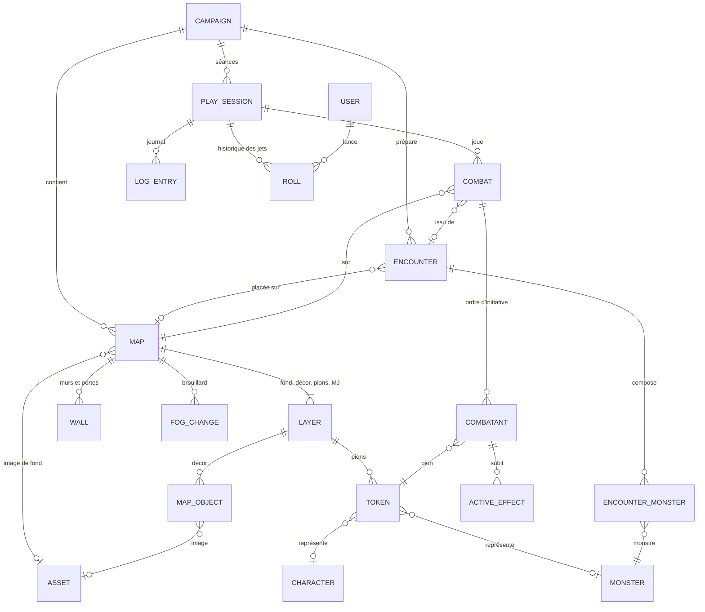

# Modèle de données (v1)

> **Statut : v1, à relire par les deux autres membres** (issue #13).
> Base : PostgreSQL, accès par Drizzle (ADR-0004). Le schéma Drizzle sera écrit à partir de ce document ; en cas d'écart, c'est ce document qu'on met à jour dans la même PR.

## 1. Deux familles de données

| Famille | Contenu | Écrite par | Cycle de vie |
|---|---|---|---|
| **Données de règles** | Espèces, classes, sous-classes, historiques, dons, sorts, objets (équipement et objets magiques), monstres, états | Le script d'import uniquement (ADR-0006) | Importées depuis le SRD 5.2, versionnées, **en lecture seule** pour l'application |
| **Données de partie** | Utilisateurs, campagnes, personnages, cartes, rencontres, combats, jets, journal, notes, documents | Le serveur, à la demande des utilisateurs | Créées et modifiées pendant la vie du produit |

Règles de séparation :

- Les données de partie **référencent** les données de règles par leur identifiant stable (`srd-2024_fireball`), **jamais par copie**. Un nouvel import corrige donc tous les personnages et toutes les rencontres.
- Une donnée de règles n'a **aucune clé étrangère** vers une donnée de partie. On peut vider et réimporter les tables de règles sans toucher aux parties.
- Les deux familles sont dans deux **schémas PostgreSQL** distincts : `rules` et `game`. Le rôle de base de données de l'application n'a que le droit de lecture sur `rules` ; seul le script d'import peut y écrire.
- Un identifiant de règles inconnu dans une donnée de partie (par exemple un sort retiré par un nouvel import) n'est pas supprimé : le moteur le signale comme **erreur de validation** et le personnage reste lisible.

## 2. Conventions

| Sujet | Convention |
|---|---|
| Nommage | Tables et colonnes en `snake_case` anglais dans la base, `camelCase` côté TypeScript (Drizzle fait la conversion). Documentation en français. |
| Identifiants de règles | `text`, clé Open5e de l'entrée (`srd-2024_fireball`). Contenu créé dans le produit : préfixe `custom_` (format-des-regles.md, section 2). |
| Identifiants de partie | `uuid` v7 générés par le service qui crée l'entité (`v7()` du paquet `uuid`, ADR-0008) : triables par date, sans compteur devinable dans les URL. Pas de valeur par défaut en base. |
| Dates | `timestamptz`, en UTC. Toute table de partie a `created_at` (fixé par le service, `defaultNow()` en filet) et `updated_at` (`$onUpdate` de Drizzle, `defaultNow()` à l'insertion). |
| Données structurées | `jsonb` pour ce qui suit le format des règles ou des choix de création. Chaque colonne `jsonb` a un schéma de validation dans `packages/shared` (format-des-regles.md, section 9) ; aucune donnée non validée n'est écrite. |
| Textes affichables | Jamais dans les colonnes lues par le moteur. Les textes du SRD sont dans `rules.rule_text`, par langue. Le serveur renvoie des codes (ADR-0004). |
| Énumérations | Types `enum` PostgreSQL, générés depuis les mêmes listes TypeScript que le moteur. |
| Suppression | Pas de suppression logique. La suppression d'une campagne supprime en cascade tout ce qui en dépend, sauf les personnages, qui reviennent à leur propriétaire (`campaign_id` remis à `null`). |
| Concurrence | Les entités modifiées depuis plusieurs clients (personnage, combat) ont une colonne `version` incrémentée à chaque écriture. Une écriture qui part d'une version périmée est refusée avec un code d'erreur. |

## 3. Données de règles

```mermaid
erDiagram
    IMPORT_VERSION ||--o{ RULE_ENTRY : "a importé"
    RULE_ENTRY ||--o{ RULE_TEXT : "textes par langue"
    RULE_ENTRY ||--o| SPECIES : ""
    RULE_ENTRY ||--o| CLASS : ""
    RULE_ENTRY ||--o| SUBCLASS : ""
    RULE_ENTRY ||--o| BACKGROUND : ""
    RULE_ENTRY ||--o| FEAT : ""
    RULE_ENTRY ||--o| SPELL : ""
    RULE_ENTRY ||--o| ITEM : ""
    RULE_ENTRY ||--o| MONSTER : ""
    RULE_ENTRY ||--o| CONDITION : ""
    CLASS ||--o{ SUBCLASS : "se spécialise en"
    CLASS ||--o{ CLASS_SPELL : "liste de sorts"
    SPELL ||--o{ CLASS_SPELL : "accessible à"
    BACKGROUND }o--o| FEAT : "don d'origine"
```

- **`rule_entry`** est la table commune à toutes les données de règles : identifiant, type, version d'import, statut de relecture. Chaque type a ensuite sa propre table avec ses colonnes de recherche (niveau de sort, facteur de puissance…) et ses données structurées en `jsonb`.
- Les **actions** (sorts, attaques d'armes, actions de monstres) suivent le [format de description des règles](format-des-regles.md). Un sort est une action ; une arme porte son action dans `item.data` ; un monstre porte la liste de ses actions dans `monster.data`.
- **`class_spell`** est une vraie table plutôt qu'un tableau dans `spell` : l'assistant de création filtre souvent « les sorts de niveau 1 du magicien ».

## 4. Données de partie

Le schéma est découpé en deux vues pour rester lisible. `SPECIES`, `CLASS`, `SPELL`, `ITEM`, `MONSTER`… sont des entités de règles (section 3).

### 4.1 Comptes, campagnes et personnages

```mermaid
erDiagram
    USER ||--o{ AUTH_SESSION : "se connecte"
    USER ||--o{ CAMPAIGN_MEMBER : "participe"
    CAMPAIGN ||--o{ CAMPAIGN_MEMBER : "réunit"
    CAMPAIGN ||--o{ TABLE_VIEW_LINK : "vue de table"
    USER ||--o{ CHARACTER : "possède"
    CAMPAIGN |o--o{ CHARACTER : "inclut"
    CHARACTER ||--|| CHARACTER_STATE : "état courant"
    CHARACTER }o--|| SPECIES : "espèce"
    CHARACTER }o--|| BACKGROUND : "historique"
    CHARACTER ||--o{ CHARACTER_LEVEL : "niveaux gagnés"
    CHARACTER_LEVEL }o--|| CLASS : "dans la classe"
    CHARACTER_LEVEL }o--o| SUBCLASS : "sous-classe choisie"
    CHARACTER ||--o{ KNOWN_SPELL : "connaît"
    KNOWN_SPELL }o--|| SPELL : "sort"
    CHARACTER ||--o{ INVENTORY_ITEM : "porte"
    INVENTORY_ITEM }o--o| ITEM : "objet du SRD"
    CAMPAIGN ||--o{ NOTE : "notes, PNJ, lieux, quêtes"
    CAMPAIGN ||--o{ DOCUMENT : "à révéler"
    CAMPAIGN ||--o{ ASSET : "images"
    DOCUMENT }o--o| ASSET : "image"
```

### 4.2 Cartes, rencontres, combat et jets



## 5. Choix de modélisation

### 5.1 Personnage : les choix, pas les résultats

- `character` stocke les **choix** du joueur : espèce, historique, méthode et valeurs de base des caractéristiques, compétences et langues choisies.
- `character_level` stocke **un niveau par ligne**, avec les choix faits à ce niveau (PV, sous-classe, augmentation de caractéristique ou don, sorts appris). Le moteur recalcule la fiche en rejouant les niveaux dans l'ordre : la montée de niveau est un ajout de ligne, et un retour en arrière une suppression de la dernière ligne. Le multiclassage n'est pas prévu en v1, mais ce découpage ne l'empêche pas.
- Les **statistiques dérivées** (modificateurs, bonus de maîtrise, CA, PV max, sauvegardes, emplacements de sorts, poids porté) ne sont **pas stockées** comme source de vérité. `character.derived_cache` en garde une copie pour l'affichage des listes, recalculée à chaque écriture et ignorée si `rules_import_id` ne correspond plus au dernier import.
- `character_state` sépare l'**état courant** (PV, PV temporaires, dés de vie et emplacements utilisés, jets contre la mort, états hors combat) des choix de création : un repos long ne touche que cette table.

### 5.2 Créatures sur la carte

- Un **pion** (`token`) est l'instance d'une créature sur une carte. Pour un personnage, il pointe vers `character` et l'état vient de `character_state`. Pour un monstre, il pointe vers `monster` et porte lui-même ses PV : deux gobelins sont deux pions avec leurs propres PV.
- Un **combattant** (`combatant`) est un pion engagé dans un combat : initiative, ressources du tour, effets en cours. Le combat ne copie pas les PV : il modifie ceux du pion ou du personnage, via le journal.

### 5.3 Visibilité

Chaque donnée affichable en partie porte une visibilité, lue par la projection de chaque canal (ADR-0005). Toutes les tables utilisent **le même type enum PostgreSQL `visibility`**. Une table qui n'accepte qu'une partie des valeurs le précise par une contrainte `check`.

| Valeur | MJ | Joueur | Vue de table |
|---|---|---|---|
| `public` | oui | oui | oui |
| `owner` | oui | seulement le propriétaire de la donnée | non |
| `gm` | oui | non | non |

Le propriétaire d'une donnée `owner` est donné par une colonne de la table : `roll.user_id`, `log_entry.owner_id`, `character.owner_id` pour les notes du personnage.

| Entité | Règle de visibilité |
|---|---|
| `layer` de type `gm` | Le calque et tout son contenu sont `gm`. |
| `token` | `hidden = true` ou pion sous le brouillard : absent des projections joueurs et vue de table. PV remplacés par un état approximatif (`unhurt`, `wounded`, `down`) pour les monstres. |
| `fog_change` | Seul le résultat (zones révélées) est projeté ; jamais la position des murs ou pions sous le brouillard. |
| `roll` | `public` ; `owner` (jet secret d'un joueur, vu par lui et le MJ) ; `gm` (jet caché du MJ, vu par lui seul). |
| `note` | `gm` par défaut ; `public` pour une note partagée avec les joueurs. Pas de `owner`. |
| `document` | Visible des joueurs seulement après `revealed_at`. |
| `log_entry` | Reprend la visibilité de l'action journalisée : un jet `owner` donne une entrée `owner` (même propriétaire), un jet `gm` une entrée `gm`. |
| `active_effect` | `public` par défaut ; le MJ peut le passer en `gm` (malédiction secrète). |

Le filtrage se fait **côté serveur, avant l'envoi** ; les tests de filtrage (issue « Filtrage serveur ») s'appuient sur ce tableau.

### 5.4 Journal et annulation

- Toute action de partie appliquée (dégâts, déplacement, ouverture de porte, effet ajouté…) crée une `log_entry` avec la liste des modifications **et leur inverse** au format JSON Patch, appliquées à l'état de la campagne.
- Annuler une action rejoue l'inverse et crée une nouvelle entrée qui pointe vers l'entrée annulée (`undoes_id`). On n'efface jamais une entrée : l'historique reste complet.
- Le journal est ordonné par `seq`, un compteur propre à chaque campagne, pour ne pas dépendre de l'horloge.

### 5.5 Ce qui n'est pas stocké

| Donnée | Pourquoi |
|---|---|
| Statistiques dérivées du personnage | Recalculées par le moteur (sauf le cache d'affichage, section 5.1). |
| Difficulté d'une rencontre | Calculée à partir des monstres et du groupe, qui peuvent changer. |
| Ligne de vue | Calculée à partir des murs, des portes et des pions. Seules les zones déjà révélées sont stockées (`fog_change`). |
| Projections MJ, joueurs, vue de table | En mémoire sur le serveur, reconstruites depuis la base au redémarrage (ADR-0005). |

## 6. Dictionnaire des champs

Légende : **PK** clé primaire, **FK** clé étrangère, ✔ obligatoire.

### 6.1 Données de règles (schéma `rules`)

#### `import_version`

Une ligne par exécution du script d'import (ADR-0006).

| Champ | Type | Obl. | Description |
|---|---|---|---|
| `id` | `uuid` PK | ✔ | |
| `source` | `text` | ✔ | `open5e-v2` |
| `document_key` | `text` | ✔ | `srd-2024` |
| `cache_hash` | `text` | ✔ | Empreinte SHA-256 du cache de réponses brutes utilisé |
| `started_at` / `finished_at` | `timestamptz` | ✔ / | Début et fin de l'exécution |
| `status` | enum `running`, `succeeded`, `failed` | ✔ | |
| `counts` | `jsonb` | | Nombre d'entrées par ressource : `{ "spells": 339, … }` |

#### `rule_entry`

| Champ | Type | Obl. | Description |
|---|---|---|---|
| `id` | `text` PK | ✔ | Clé Open5e (`srd-2024_fireball`) ou `custom_…` |
| `kind` | enum `species`, `class`, `subclass`, `background`, `feat`, `spell`, `item`, `monster`, `condition` | ✔ | Table de détail correspondante |
| `import_id` | `uuid` FK `import_version` | ✔ | Dernier import qui a écrit l'entrée |
| `review` | enum `auto`, `checked` | ✔ | Statut de relecture (format-des-regles.md, section 7) |
| `source_hash` | `text` | ✔ | Empreinte de la réponse brute : un import qui ne change rien n'écrit rien |

#### `rule_text`

Textes affichables, par langue (ADR-0006). `en` est la langue de référence.

| Champ | Type | Obl. | Description |
|---|---|---|---|
| `entry_id` | `text` FK `rule_entry` | ✔ | PK avec `lang` |
| `lang` | `text` | ✔ | Code BCP 47 : `en`, `fr` |
| `name` | `text` | ✔ | Nom affiché |
| `description` | `text` | | Texte du SRD, en Markdown |
| `extra` | `jsonb` | | Textes secondaires (noms des actions d'un monstre, des capacités de classe…), indexés par leur identifiant |

#### Tables de détail

Chacune a pour clé `id` (`text`, PK et FK vers `rule_entry`) et une colonne `data` (`jsonb`) validée par le schéma de son type. Seules les colonnes utiles aux recherches sont sorties du `jsonb`.

| Table | Colonnes en plus de `id` et `data` | Contenu de `data` |
|---|---|---|
| `species` | `size`, `speed_ft` | Traits, vision dans le noir, sous-espèces (lignées) |
| `class` | `hit_die` (`int`), `spellcasting_ability` (enum ou `null`) | Maîtrises, sauvegardes, équipement de départ, capacités par niveau (1 à 20), table des emplacements, nombre de sorts connus ou préparés |
| `subclass` | `class_id` FK `class`, `level` | Capacités par niveau |
| `background` | `feat_id` FK `feat` | Caractéristiques proposées, compétences, outil, équipement de départ |
| `feat` | `category` (enum `origin`, `general`, `fightingStyle`, `epicBoon`), `prerequisite` (`jsonb`) | Effets du don |
| `spell` | `level` (0 à 9), `school`, `ritual`, `concentration` | Action au format des règles |
| `class_spell` | `class_id` FK `class`, `spell_id` FK `spell` (PK composite, pas de `data`) | |
| `item` | `category` (enum `weapon`, `armor`, `gear`, `tool`, `magicItem`…), `rarity`, `weight_lb` (`numeric`), `cost_cp` (`int`), `requires_attunement` | CA et contraintes d'une armure, action et propriétés d'une arme, effets d'un objet magique |
| `monster` | `creature_type`, `size`, `challenge_rating` (`numeric`), `xp` (`int`) | Caractéristiques, CA, PV (dés et moyenne), vitesses, sauvegardes, compétences, résistances, immunités, sens, langues, actions au format des règles |
| `condition` | aucune | Effets mécaniques de l'état (désavantages, vitesse nulle…) |

Index : recherche du bestiaire sur `monster (creature_type, challenge_rating, size)` ; assistant sur `spell (level)` et `class_spell (class_id)` ; recherche par nom sur `rule_text (lang, name)` avec `pg_trgm`.

### 6.2 Comptes et campagnes (schéma `game`)

#### `app_user`

`user` est un mot réservé de PostgreSQL : la table s'appelle `app_user` (entité `USER` dans les schémas).

| Champ | Type | Obl. | Description |
|---|---|---|---|
| `id` | `uuid` PK | ✔ | |
| `email` | `citext` unique | ✔ | Identifiant de connexion |
| `role` | enum `user_role` : `admin`, `user` | ✔ | Rôle sur tout le produit, `user` par défaut. À ne pas confondre avec le rôle dans une campagne (`campaign_member.role` : `gm`, `player`) |
| `password_hash` | `text` | ✔ | Argon2id, 19 Mio de mémoire, 2 itérations, 1 fil (minimum recommandé par l'OWASP) |
| `display_name` | `text` | ✔ | Nom affiché aux autres membres |
| `locale` | `text` | ✔ | Langue de l'interface, `en` par défaut |
| `preferences` | `jsonb` | ✔ | Préférences d'accessibilité (animations des dés, taille de la grille…). `{}` par défaut : jamais `null` |

#### `auth_session`

| Champ | Type | Obl. | Description |
|---|---|---|---|
| `id` | `uuid` PK | ✔ | |
| `user_id` | `uuid` FK `app_user` | ✔ | |
| `token_hash` | `text` unique | ✔ | Empreinte SHA-256 du jeton (256 bits aléatoires) ; le jeton lui-même n'est jamais stocké |
| `client` | enum `web`, `mobile` | ✔ | Cookie de session (web) ou jeton porteur (mobile) |
| `expires_at` | `timestamptz` | ✔ | 7 jours après l'ouverture, sans prolongation |
| `revoked_at` | `timestamptz` | | Déconnexion. Une session déjà révoquée garde sa première date |

#### `campaign`

| Champ | Type | Obl. | Description |
|---|---|---|---|
| `id` | `uuid` PK | ✔ | |
| `name` | `text` | ✔ | |
| `description` | `text` | | |
| `invite_code_hash` | `text` | | Empreinte du code d'invitation en cours ; `null` : invitations fermées |
| `invite_expires_at` | `timestamptz` | | |
| `active_map_id` | `uuid` FK `map` | | Carte affichée sur la vue de table |
| `version` | `int` | ✔ | Version de l'état de partie, reprise par les projections (ADR-0005) |
| `next_log_seq` | `bigint` | ✔ | Compteur du journal |

#### `campaign_member`

| Champ | Type | Obl. | Description |
|---|---|---|---|
| `campaign_id` | `uuid` FK `campaign` | ✔ | PK avec `user_id` |
| `user_id` | `uuid` FK `app_user` | ✔ | |
| `role` | enum `gm`, `player` | ✔ | Un seul `gm` par campagne (index unique partiel). Un utilisateur peut être `gm` d'une campagne et `player` d'une autre. |
| `joined_at` | `timestamptz` | ✔ | |

#### `table_view_link`

Lien de la vue de table : lecture seule, révocable par le MJ (ADR-0005).

| Champ | Type | Obl. | Description |
|---|---|---|---|
| `id` | `uuid` PK | ✔ | |
| `campaign_id` | `uuid` FK `campaign` | ✔ | |
| `token_hash` | `text` unique | ✔ | Empreinte du jeton présent dans le lien |
| `revoked_at` | `timestamptz` | | |

#### `note`

| Champ | Type | Obl. | Description |
|---|---|---|---|
| `id` | `uuid` PK | ✔ | |
| `campaign_id` | `uuid` FK `campaign` | ✔ | |
| `kind` | enum `note`, `npc`, `location`, `quest` | ✔ | |
| `title` | `text` | ✔ | |
| `body` | `text` | | Markdown |
| `visibility` | `visibility` : `gm` ou `public` | ✔ | `gm` par défaut |
| `status` | enum `open`, `done` | | Quêtes uniquement |

#### `document`

| Champ | Type | Obl. | Description |
|---|---|---|---|
| `id` | `uuid` PK | ✔ | |
| `campaign_id` | `uuid` FK `campaign` | ✔ | |
| `kind` | enum `letter`, `image`, `clue` | ✔ | |
| `title` | `text` | ✔ | |
| `body` | `text` | | Texte de la lettre ou de l'indice |
| `asset_id` | `uuid` FK `asset` | | Image |
| `alt_text` | `text` | | Obligatoire si `asset_id` est renseigné (accessibilité) |
| `revealed_at` | `timestamptz` | | `null` : caché aux joueurs |

#### `asset`

Images importées par le MJ : fonds de carte, décors, pions, documents.

| Champ | Type | Obl. | Description |
|---|---|---|---|
| `id` | `uuid` PK | ✔ | |
| `campaign_id` | `uuid` FK `campaign` | ✔ | |
| `uploaded_by` | `uuid` FK `app_user` | ✔ | |
| `mime_type` | `text` | ✔ | Liste blanche : PNG, JPEG, WebP |
| `size_bytes` | `int` | ✔ | Taille plafonnée |
| `sha256` | `text` | ✔ | Nom du fichier sur disque (hors de la base) |
| `credit` | `text` | ✔ | Auteur et licence (visuels libres et crédités, §01-C) |

### 6.3 Personnages

#### `character`

| Champ | Type | Obl. | Description |
|---|---|---|---|
| `id` | `uuid` PK | ✔ | |
| `owner_id` | `uuid` FK `app_user` | ✔ | Joueur propriétaire |
| `campaign_id` | `uuid` FK `campaign` | | `null` tant que le personnage n'a rejoint aucune campagne |
| `name` | `text` | ✔ | |
| `status` | enum `draft`, `complete` | ✔ | Un brouillon peut être invalide ; un personnage `complete` a été validé par le moteur |
| `species_id` | `text` FK `rules.species` | | Obligatoire si `complete` |
| `background_id` | `text` FK `rules.background` | | Obligatoire si `complete` |
| `ability_method` | enum `pointBuy`, `standardArray`, `roll` | | |
| `base_abilities` | `jsonb` | | `{ "STR": 15, "DEX": 14, … }` avant bonus. Pour `roll`, les jets sont les lignes `roll` du personnage avec `reason = abilityScores` (pas de référence dans le `jsonb`) ; le moteur vérifie que les valeurs en proviennent |
| `choices` | `jsonb` | | Choix de création hors niveaux : compétences, langues, outils, répartition des bonus de l'historique, équipement de départ |
| `details` | `jsonb` | | Apparence, alignement, personnalité (texte libre) |
| `portrait_asset_id` | `uuid` FK `asset` | | |
| `derived_cache` | `jsonb` | | Fiche calculée par le moteur, pour l'affichage seulement (section 5.1) |
| `rules_import_id` | `uuid` FK `rules.import_version` | | Import utilisé pour le dernier calcul |
| `version` | `int` | ✔ | Concurrence (section 2) |

#### `character_level`

| Champ | Type | Obl. | Description |
|---|---|---|---|
| `character_id` | `uuid` FK `character` | ✔ | PK avec `level` |
| `level` | `int` 1 à 20 | ✔ | Niveau total atteint par cette ligne (1 à 5 exigés, 6 à 20 en bonus) |
| `class_id` | `text` FK `rules.class` | ✔ | |
| `subclass_id` | `text` FK `rules.subclass` | | Au niveau où la classe la choisit |
| `hp_method` | enum `max`, `average`, `roll` | ✔ | `max` imposé au niveau 1 |
| `hp_roll_id` | `uuid` FK `roll` | | Obligatoire si `hp_method` vaut `roll`, `null` sinon (contrainte `check`) |
| `choices` | `jsonb` | | Augmentation de caractéristique ou don, sorts appris, options de capacités |

#### `character_state`

| Champ | Type | Obl. | Description |
|---|---|---|---|
| `character_id` | `uuid` PK, FK `character` | ✔ | |
| `hp_current` | `int` | ✔ | |
| `hp_temp` | `int` | ✔ | 0 par défaut |
| `hit_dice_used` | `jsonb` | ✔ | Par taille de dé : `{ "d10": 1 }` |
| `spell_slots_used` | `jsonb` | ✔ | Par niveau : `{ "1": 2 }` |
| `resource_uses` | `jsonb` | ✔ | Utilisations des capacités limitées : `{ "srd-2024_second-wind": 1 }` |
| `death_saves` | `jsonb` | ✔ | `{ "successes": 0, "failures": 0 }` |
| `conditions` | `jsonb` | | États hors combat, dont le niveau d'épuisement |
| `currency` | `jsonb` | ✔ | `{ "cp": 0, "sp": 0, "ep": 0, "gp": 15, "pp": 0 }` |
| `notes` | `text` | | Notes du joueur, visibilité `owner` |

#### `known_spell`

| Champ | Type | Obl. | Description |
|---|---|---|---|
| `character_id` | `uuid` FK `character` | ✔ | PK avec `spell_id` et `class_id` |
| `spell_id` | `text` FK `rules.spell` | ✔ | |
| `class_id` | `text` FK `rules.class` | ✔ | Classe qui donne le sort (caractéristique d'incantation) |
| `prepared` | `bool` | ✔ | Préparé aujourd'hui ; toujours `true` pour un sort connu ou toujours préparé |
| `always_prepared` | `bool` | ✔ | Donné par une capacité, ne compte pas dans la limite |

#### `inventory_item`

| Champ | Type | Obl. | Description |
|---|---|---|---|
| `id` | `uuid` PK | ✔ | |
| `character_id` | `uuid` FK `character` | ✔ | |
| `item_id` | `text` FK `rules.item` | | `null` pour un objet libre |
| `custom_name` | `text` | | Obligatoire si `item_id` est `null` |
| `custom_weight_lb` | `numeric` | | Poids d'un objet libre |
| `quantity` | `int` | ✔ | ≥ 1 |
| `equipped` | `bool` | ✔ | Compte pour la CA et les attaques |
| `attuned` | `bool` | ✔ | 3 objets harmonisés au plus (validé par le moteur) |

### 6.4 Cartes

#### `map`

| Champ | Type | Obl. | Description |
|---|---|---|---|
| `id` | `uuid` PK | ✔ | |
| `campaign_id` | `uuid` FK `campaign` | ✔ | |
| `name` | `text` | ✔ | |
| `grid_type` | enum `square`, `hex` | ✔ | |
| `width_cells` / `height_cells` | `int` | ✔ | Taille de la carte en cases |
| `cell_px` | `int` | ✔ | Taille d'une case sur l'image de fond |
| `cell_ft` | `int` | ✔ | 5 par défaut |
| `background_asset_id` | `uuid` FK `asset` | | |
| `background_offset` | `jsonb` | | Décalage de l'image par rapport à la grille |
| `fog_enabled` | `bool` | ✔ | |

Coordonnées : en cases, en nombres décimaux (un mur passe entre deux cases, un pion de taille G occupe 2 × 2 cases). Pour une grille hexagonale, coordonnées axiales.

#### `layer`

Quatre calques par carte, créés avec elle.

| Champ | Type | Obl. | Description |
|---|---|---|---|
| `id` | `uuid` PK | ✔ | |
| `map_id` | `uuid` FK `map` | ✔ | |
| `kind` | enum `background`, `decor`, `tokens`, `gm` | ✔ | Unique par carte. `gm` : invisible des joueurs |
| `sort_order` | `int` | ✔ | Ordre d'affichage |

#### `map_object`

| Champ | Type | Obl. | Description |
|---|---|---|---|
| `id` | `uuid` PK | ✔ | |
| `layer_id` | `uuid` FK `layer` | ✔ | |
| `asset_id` | `uuid` FK `asset` | | Image, ou forme dessinée si `null` |
| `shape` | `jsonb` | ✔ | Position, taille, rotation ou polygone |
| `label` | `text` | | Nom lu par la vue textuelle de la carte (accessibilité) |

#### `wall`

| Champ | Type | Obl. | Description |
|---|---|---|---|
| `id` | `uuid` PK | ✔ | |
| `map_id` | `uuid` FK `map` | ✔ | |
| `x1`, `y1`, `x2`, `y2` | `real` | ✔ | Segment, en cases |
| `kind` | enum `wall`, `door` | ✔ | |
| `door_state` | enum `open`, `closed`, `locked` | | Portes uniquement. Une porte ouverte ne bloque ni la vue ni le déplacement |
| `blocks_sight` / `blocks_movement` | `bool` | ✔ | `true` par défaut ; permet une fenêtre (bloque le déplacement, pas la vue) |

#### `fog_change`

Révélations et masquages successifs, appliqués dans l'ordre. L'état du brouillard est leur cumul.

| Champ | Type | Obl. | Description |
|---|---|---|---|
| `id` | `uuid` PK | ✔ | |
| `map_id` | `uuid` FK `map` | ✔ | |
| `seq` | `bigint` | ✔ | Ordre d'application |
| `mode` | enum `reveal`, `hide` | ✔ | |
| `source` | enum `gm`, `vision` | ✔ | Révélation manuelle par le MJ ou automatique par la ligne de vue |
| `region` | `jsonb` | ✔ | Ensemble de cases ou polygone |

Quand l'historique devient long, le serveur peut le compacter en une seule ligne `reveal` équivalente.

#### `token`

| Champ | Type | Obl. | Description |
|---|---|---|---|
| `id` | `uuid` PK | ✔ | |
| `layer_id` | `uuid` FK `layer` | ✔ | Calque `tokens` ou `gm`. La carte se déduit du calque : pas de `map_id`, pour éviter deux sources qui se contredisent |
| `character_id` | `uuid` FK `character` | | Exactement un de `character_id` et `monster_id` (contrainte `check`) |
| `monster_id` | `text` FK `rules.monster` | | |
| `label` | `text` | ✔ | « Gobelin 2 » : nom distinct, lu par la vue textuelle |
| `x`, `y` | `real` | ✔ | Position en cases |
| `size` | enum `tiny` à `gargantuan` | ✔ | Reprise de la créature, modifiable |
| `hidden` | `bool` | ✔ | Caché par le MJ même hors brouillard |
| `disposition` | enum `ally`, `neutral`, `enemy` | ✔ | Affichée par une forme et un texte, jamais par la seule couleur |
| `hp_current`, `hp_max`, `hp_temp` | `int` | | Monstres uniquement ; `hp_max` tiré ou moyen à la création du pion |
| `asset_id` | `uuid` FK `asset` | | Image du pion |

#### `encounter`

| Champ | Type | Obl. | Description |
|---|---|---|---|
| `id` | `uuid` PK | ✔ | |
| `campaign_id` | `uuid` FK `campaign` | ✔ | |
| `name` | `text` | ✔ | |
| `map_id` | `uuid` FK `map` | | Carte de placement |
| `placed_at` | `timestamptz` | | Date du placement des pions en un clic |
| `notes` | `text` | | Notes du MJ (`gm`) |

#### `encounter_monster`

| Champ | Type | Obl. | Description |
|---|---|---|---|
| `id` | `uuid` PK | ✔ | |
| `encounter_id` | `uuid` FK `encounter` | ✔ | |
| `monster_id` | `text` FK `rules.monster` | ✔ | |
| `quantity` | `int` | ✔ | ≥ 1 |
| `positions` | `jsonb` | | Positions prévues sur la carte, une par exemplaire |
| `hidden` | `bool` | ✔ | Pions créés cachés |

### 6.5 Séances, combat, journal et jets

#### `play_session`

Une séance de jeu : délimite « l'historique complet de la session » (§02-E).

| Champ | Type | Obl. | Description |
|---|---|---|---|
| `id` | `uuid` PK | ✔ | |
| `campaign_id` | `uuid` FK `campaign` | ✔ | |
| `started_at` | `timestamptz` | ✔ | |
| `ended_at` | `timestamptz` | | `null` : séance en cours (une seule par campagne) |

#### `combat`

| Champ | Type | Obl. | Description |
|---|---|---|---|
| `id` | `uuid` PK | ✔ | |
| `session_id` | `uuid` FK `play_session` | ✔ | |
| `map_id` | `uuid` FK `map` | ✔ | |
| `encounter_id` | `uuid` FK `encounter` | | |
| `status` | enum `rollingInitiative`, `active`, `ended` | ✔ | |
| `round` | `int` | ✔ | Commence à 1 |
| `turn_index` | `int` | ✔ | Position dans l'ordre d'initiative |
| `version` | `int` | ✔ | Concurrence (section 2) |

#### `combatant`

| Champ | Type | Obl. | Description |
|---|---|---|---|
| `id` | `uuid` PK | ✔ | |
| `combat_id` | `uuid` FK `combat` | ✔ | |
| `token_id` | `uuid` FK `token` | ✔ | |
| `initiative` | `int` | | Total du jet |
| `initiative_roll_id` | `uuid` FK `roll` | | |
| `turn_order` | `int` | ✔ | Ordre final, égalités départagées par le MJ |
| `turn_state` | `jsonb` | ✔ | Ressources du tour : action, action bonus, réaction, mouvement restant |
| `concentration_effect_id` | `uuid` FK `active_effect` | | Sort maintenu par concentration |
| `defeated` | `bool` | ✔ | Retiré de l'ordre des tours |

#### `active_effect`

Effet en cours sur un combattant, au format des effets génériques (format-des-regles.md, section 4).

| Champ | Type | Obl. | Description |
|---|---|---|---|
| `id` | `uuid` PK | ✔ | |
| `target_id` | `uuid` FK `combatant` | ✔ | |
| `source_id` | `uuid` FK `combatant` | | `null` pour un effet libre du MJ |
| `action_id` | `text` | | Action d'origine (`srd-2024_bless`) |
| `effect` | `jsonb` | ✔ | Un effet `condition`, `modifier` ou `custom` |
| `started_round` | `int` | ✔ | Pour calculer la fin de la durée |
| `uses_left` | `int` | | Pour un `modifier` limité en utilisations |
| `save_dc` | `int` | | DD retenu pour les sauvegardes répétées |
| `visibility` | `visibility` : `public` ou `gm` | ✔ | |

#### `log_entry`

| Champ | Type | Obl. | Description |
|---|---|---|---|
| `id` | `uuid` PK | ✔ | |
| `campaign_id` | `uuid` FK `campaign` | ✔ | Redondant avec la séance, mais nécessaire à la contrainte d'unicité de `seq` |
| `session_id` | `uuid` FK `play_session` | ✔ | |
| `combat_id` | `uuid` FK `combat` | | |
| `seq` | `bigint` | ✔ | Unique avec `campaign_id` |
| `actor_id` | `uuid` FK `app_user` | ✔ | Qui a confirmé l'action (le MJ, en général) |
| `code` | `text` | ✔ | Code de l'événement (`combat.damageApplied`), traduit par le client |
| `params` | `jsonb` | ✔ | Paramètres du code |
| `forward` | `jsonb` | ✔ | Modifications appliquées (JSON Patch) |
| `inverse` | `jsonb` | ✔ | Modifications inverses, pour l'annulation |
| `undoes_id` | `uuid` FK `log_entry` | | Entrée annulée par celle-ci |
| `visibility` | `visibility` | ✔ | Section 5.3 |
| `owner_id` | `uuid` FK `app_user` | | Obligatoire si `visibility` vaut `owner` (contrainte `check`) |

#### `roll`

| Champ | Type | Obl. | Description |
|---|---|---|---|
| `id` | `uuid` PK | ✔ | |
| `user_id` | `uuid` FK `app_user` | ✔ | Qui a lancé |
| `session_id` | `uuid` FK `play_session` | | `null` : jet hors séance (création de personnage, fiche) |
| `character_id` | `uuid` FK `character` | | Personnage concerné |
| `expression` | `text` | ✔ | Telle que saisie, après normalisation (des.md) |
| `reason` | `text` | | Code : `skill.stealth`, `attack`, `initiative`, `abilityScores`, `hitPoints`… |
| `detail` | `jsonb` | ✔ | Résultat de chaque dé, dés gardés, explosions, relances |
| `total` | `int` | ✔ | |
| `visibility` | `visibility` | ✔ | Section 5.3 ; le propriétaire est `user_id` |
| `client` | enum `web`, `mobile` | ✔ | Origine du jet |
| `created_at` | `timestamptz` | ✔ | |

## 7. Suite

- Le schéma Drizzle et la première migration sont écrits avec le serveur (comptes : #22 ; import : #20).
- La page `donnees-de-regles.md` détaillera le contenu de chaque colonne `data` des tables de règles, à partir de l'import réel.
- La campagne de démonstration (§02-L) sert de jeu d'essai du modèle : 4 personnages, 3 cartes dont une avec murs et portes, une rencontre par carte.
