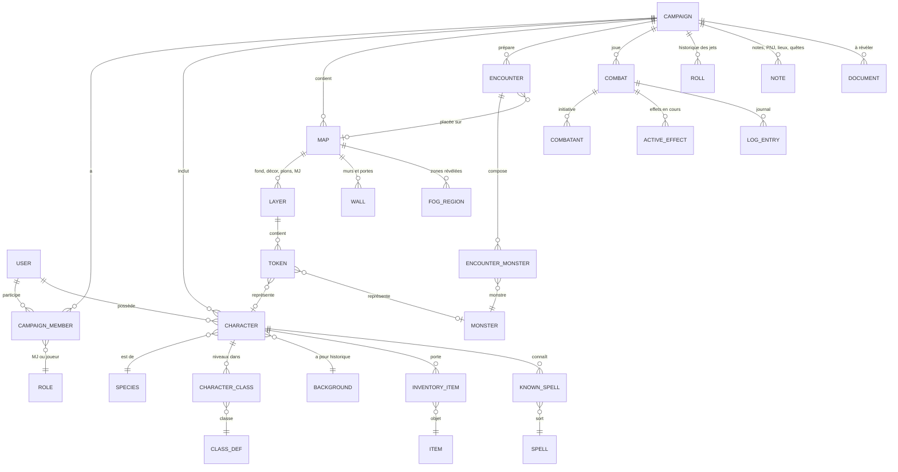

# Modèle de données (brouillon v1)

> À relire par toute l'équipe. Le dictionnaire des champs est complété au fil des issues.

## 1. Deux familles de données

| Famille | Contenu | Cycle de vie |
|---|---|---|
| **Données de règles** | Espèces, classes, sous-classes, historiques, sorts, équipements, objets magiques, monstres, états | Importées depuis le SRD, versionnées, **en lecture seule** pour l'application |
| **Données de partie** | Utilisateurs, campagnes, personnages, cartes, rencontres, combats, jets, journal | Créées et modifiées par les utilisateurs |

Les données de partie **référencent** les données de règles par identifiant stable (ex. `spell.fireball`), jamais par copie, pour qu'un nouvel import corrige tout.

## 2. Schéma des entités (première version)

## 3. Points d'attention

- **Personnage** : on stocke les **choix** (espèce, classe, caractéristiques de base, compétences choisies…), et le moteur **recalcule** les statistiques dérivées. On ne stocke une valeur dérivée que comme cache.
- **État courant** du personnage (PV, PV temporaires, emplacements utilisés, états) séparé des choix de création.
- **Visibilité** : chaque entité affichable en partie porte une visibilité (`public`, `gm`, `owner`) utilisée par la projection de la vue joueurs (ADR-0005). Le calque MJ, les jets cachés et les notes privées sont `gm`.
- **Journal** : chaque action de combat appliquée enregistre de quoi être **annulée** (état avant / modifications).
- **Jets** : expression, résultat détaillé, visibilité, auteur, horodatage.
- **Import SRD** : table de versions d'import (source, version, date, empreinte).

## 4. Dictionnaire des champs

_À compléter entité par entité :_

| Entité | Champ | Type | Obligatoire | Description |
|---|---|---|---|---|
| | | | | |
